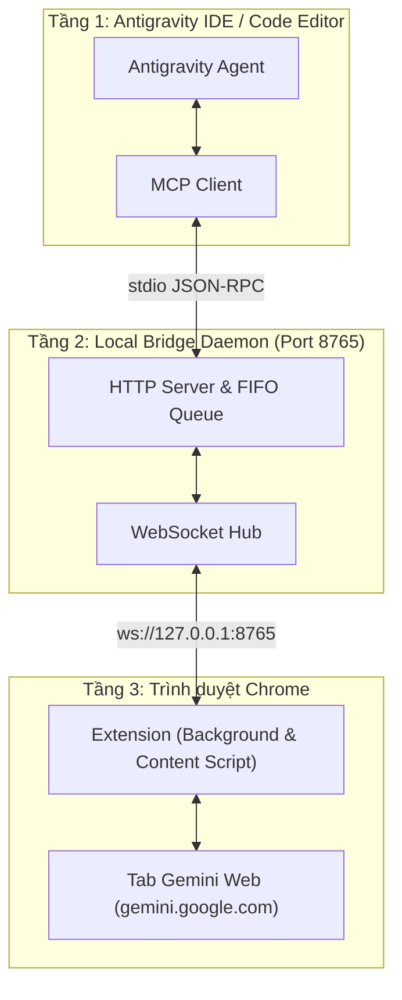

# 🚀 Antigravity Gemini Bridge

> **Cầu nối 2 chiều giữa Google Antigravity IDE và giao diện web Google Gemini.**
> Tận dụng sức mạnh các mô hình mới nhất trên web (Gemini 2.0 Flash, 1.5 Pro...) ngay trong IDE mà **không cần API Key**, **không phát sinh chi phí**, và **an toàn tuyệt đối** nhờ cơ chế Safe Mode trên tab thật.

[](https://nodejs.org/)
[](LICENSE)
[](chrome-extension/)
[](mcp-server/)
[](tests/)

---

## 💡 Tại sao bạn nên dùng?

| Vấn đề khi dùng API thông thường                                          | Giải pháp từ Antigravity Gemini Bridge                                                                                                           |
| -------------------------------------------------------------------------------- | --------------------------------------------------------------------------------------------------------------------------------------------------- |
| 💸 **Chi phí API đắt đỏ**, giới hạn token và rate limit            | ✅ **Miễn phí 100%**: Sử dụng trực tiếp gói tài khoản Gemini Web bạn đang có.                                                     |
| 🚫 **Nguy cơ khóa tài khoản** khi dùng bot/headless browser giả lập | ✅ **Visible Tab Safe Mode**: Thao tác trực tiếp trên tab Chrome thật người dùng đang mở, không bị bot detection.                 |
| 💥 **Hỏng script khi Google đổi giao diện web**                        | ✅ **Self-Healing DOM**: Bộ quét tự động thích nghi và thử hàng loạt fallback selectors khi HTML/CSS thay đổi.                    |
| 🔀 **Copy-paste thủ công** code từ web về IDE                          | ✅ **Đẩy code 1 chạm**: Tự động chèn nút **"Push to Antigravity"** vào từng khối code trên web để ghi thẳng về dự án. |

---

## ⚡ Cài đặt nhanh trong 3 bước

### Cách 1: Tự động hoàn toàn (Khuyên dùng)

**Trên Windows (PowerShell):**

```powershell
git clone https://github.com/hoanganh15092006/antigravity-gemini-bridge.git
cd antigravity-gemini-bridge
.\scripts\install.ps1
```

**Trên macOS / Linux:**

```bash
git clone https://github.com/hoanganh15092006/antigravity-gemini-bridge.git
cd antigravity-gemini-bridge
chmod +x scripts/install.sh && ./scripts/install.sh
```

---

### Cách 2: Cài đặt thủ công từng bước

#### 1. Cài dependencies & Build dự án

```bash
git clone https://github.com/hoanganh15092006/antigravity-gemini-bridge.git
cd antigravity-gemini-bridge
npm install
npm run build
```

#### 2. Khởi tạo cấu hình & Đăng ký MCP

```bash
# Tạo file .env và sinh token ngẫu nhiên
npm run cli -- init

# Tự động đăng ký MCP Server vào Antigravity
npm run install-mcp
```

#### 3. Bật Bridge Server & Cài Extension

```bash
# Khởi động server (chạy tại http://127.0.0.1:8765)
npm start
```

1. Mở trình duyệt Chrome (hoặc Brave/Edge), vào địa chỉ: `chrome://extensions/`
2. Bật công tắc **Developer mode** (góc trên bên phải).
3. Bấm nút **Load unpacked** (Tải tiện ích đã giải nén) và chọn thư mục:`antigravity-gemini-bridge/chrome-extension`
4. Mở tab mới: [https://gemini.google.com](https://gemini.google.com).
5. Bạn sẽ thấy biểu tượng **🟢 Antigravity Bridge: Connected** xuất hiện ở góc dưới bên trái tab Gemini.

---

## 🎨 Giao Diện Người Dùng Hiện Đại (Modern UI/UX Showcase)

Extension được thiết kế tỉ mỉ theo ngôn ngữ thiết kế **Dark Theme cao cấp (Linear & Raycast Style)** kết hợp hiệu ứng kính mờ **Glassmorphism**, mang lại trải nghiệm điều khiển mượt mà, trực quan và chuyên nghiệp:

### 1. Cửa Sổ Popup Điều Khiển (Extension Popup - Chiều Rộng 450px)

```text
┌────────────────────────────────────────────────────────┐
│ [AG] Antigravity Bridge                 [🔴 Đã Tắt] O── │ <- Master ON/OFF Switch
│      Smart 4x3 Multi-Model Router                      │
├────────────────────────────────────────────────────────┤
│ [4x3] Ma Trận Model & Cấp Độ Tư Duy                [v] │ <- Collapsible Drawer (38px)
├────────────────────────────────────────────────────────┤
│ CÁC TAB GEMINI ĐANG MỞ                                 │
│ ┌────────────────────────────────────────────────────┐ │
│ │ ★ ACTIVE  Giao diện Chrome Extension               │ │ <- Glassmorphism Card
│ │ #920887245   Acc u/3   [3.8 Flash (Cao)]           │ │
│ │ [ Phân tuyến: ⚡ 3.8 Flash (Cao - Viết code)     v ] │ │ <- Custom Dropdown
│ └────────────────────────────────────────────────────┘ │
│ ┌────────────────────────────────────────────────────┐ │
│ │ Quy Tắc Định Tuyến Phân Tầng                       │ │
│ │ #920887146   Acc u/2   [4 Argon (Thấp)]            │ │
│ │ [ Phân tuyến: 🎯 4 Argon (Thấp - Nhanh)          v ] │ │
│ └────────────────────────────────────────────────────┘ │
│ [ 🎯 Test Argon ]   [ ⚡ Flash Cao ]   [ 🚀 Flash Thấp ] │ <- Quick Test Buttons
├────────────────────────────────────────────────────────┤
│ 🟢 KẾT NỐI LOCAL DAEMON (127.0.0.1:8765)         Ready │
└────────────────────────────────────────────────────────┘
```

* **⚡ Công Tắc Bật / Tắt Tiện Ích (Master ON/OFF Switch)**:
  * **Gạt TẮT (`🔴 Đã Tắt`)**: Biểu tượng trên thanh công cụ chuyển sang `OFF`. Trên tất cả các tab Gemini Web đang mở, **toàn bộ huy hiệu Floating Pill, bảng điều khiển Panel, nút Push Code và Toast thông báo lập tức biến mất 100% không để lại dấu vết**, đồng thời tạm dừng toàn bộ timer quét DOM và thao tác tự động.
  * **Gạt BẬT (`🟢 Online`)**: Toàn bộ giao diện và các bộ quét DOM phục hồi ngay lập tức trong 1ms nhờ cơ chế đồng bộ thời gian thực `chrome.storage.onChanged`.
* **📐 Chiều Rộng 450px Chuẩn Mực**: Không gian rộng rãi, thoáng đãng, triệt tiêu hoàn toàn hiện tượng thanh cuộn xám thô kệch của hệ điều hành.
* **📂 Ngăn Kéo Ma Trận 4x3 Thu Gọn (Collapsible Model Matrix Drawer)**:
  * Chiều cao chỉ 38px ở trạng thái đóng, bấm icon Chevron mở ra bảng ma trận đầy đủ 4 dòng mô hình & 3 cấp độ tư duy.
* **💎 Thẻ Tab Kính Mờ (Glassmorphism Cards)**:
  * Huy hiệu `★ ACTIVE` nổi bật với viền ánh sáng ngọc bích (emerald glow) đánh dấu tab Gemini đang được Antigravity điều khiển trực tiếp.
  * Chip nhận diện: ID `#TabID`, Tài khoản (`Acc u/3`, `Acc u/2`, `Default`), và Model tag thời gian thực.
* **🎛️ Custom Dropdown Phân Tuyến Model**:
  * Thay thế dropdown mặc định của trình duyệt bằng menu tối `#0f172a` đồng bộ hoàn toàn với Dark Theme của hệ điều hành, viền sáng neon và icon mũi tên SVG sắc nét.
* **🧪 Bộ Nút Quick Test Phân Tuyến 1 Chạm**:
  * `🎯 Test Argon`: Thử nghiệm luồng phân tích kiến trúc khó.
  * `⚡ Flash Cao`: Thử nghiệm luồng viết mã nguồn tính năng.
  * `🚀 Flash Thấp`: Thử nghiệm luồng tra cứu cú pháp nhanh.

---

### 2. Giao Diện Nhúng Trực Tiếp Trên Trang Gemini (`gemini.google.com`)

Không chỉ hoạt động ngầm, tiện ích tích hợp trực quan trên chính giao diện web Gemini:

```text
+---------------------------------------------------------------------------------+
|  Google Gemini Web Interface                                                    |
|                                                                                 |
|  ```typescript                                         [ ⚡ Push to src/app.ts ] | <- Smart Push Button
|  export function calculateMetrics(...) { ... }                                  |
|  ```                                                                            |
|                                                                                 |
|                                                                                 |
|  [ 🟢 Antigravity Bridge | Safe Mode | 4 Argon (Thấp) | ⚙️ ]                     | <- Floating Pill
+---------------------------------------------------------------------------------+
```

* **🟢 Floating Status Pill (Góc Trái Dưới Màn Hình)**:
  * **Đèn LED nhịp tim (`ag-pulse`)**: Phát sáng xanh khi kết nối ổn định với Bridge Daemon local.
  * **Nhận diện Model thời gian thực**: Tự động đọc và hiển thị chính xác Model & Cấp độ tư duy đang chọn trên tab (ví dụ: `4 Argon (Thấp)`, `3.8 Flash (Cao)`).
  * **Nút bánh răng ⚙️ mở Mini Control Panel**:
    * Xem thông số kết nối daemon & Target Tab ID.
    * Công tắc bật/tắt **Auto Tool Loop** (Vòng lặp tự động gọi công cụ).
    * Nút **New Chat** và **Send Latest Code** trực tiếp ngay trên trang web.
* **⚡ Nút "Push to Antigravity" Thông Minh Trên Từng Khối Code**:
  * Tự động nhận diện tên file từ dòng chú thích đầu tiên của code (ví dụ `// src/auth.ts` -> đổi tên nút thành `⚡ Push to src/auth.ts`).
  * Bấm 1 chạm: Code được đẩy thẳng về Antigravity IDE để tự động ghi file vào dự án mà không cần bôi đen hay copy thủ công.
  * Nút chuyển sang trạng thái xanh lá `✓ Pushed!` kèm thông báo Toast nổi góc màn hình.

---

## 🎯 Hướng dẫn sử dụng (How to Use)

Dự án vận hành theo **Giao thức phối hợp 2 chiều (Collaborative Intelligence Loop)**:

* **Google Gemini Web (`gemini.google.com`)**: Đóng vai trò là **Kiến trúc sư trưởng (Master AI Architect)** — tư duy giải pháp, thiết kế thuật toán, tạo prompt kế hoạch chi tiết.
* **Antigravity IDE**: Đóng vai trò là **Kỹ sư thực thi hiện trường (Senior Execution Engineer)** — trực tiếp đọc/sửa file trong dự án, chạy terminal, chạy test và tương tác với bạn.

---

### 1. Luồng làm việc tự động trong Antigravity IDE (Khuyên dùng)

Bạn không cần mở cửa sổ Chrome lên để gõ. Bạn chỉ cần ngồi trong Antigravity IDE và ra lệnh như một quản lý dự án:

#### 💬 Các câu lệnh mẫu thực tế:

```text
# Ví dụ 1: Nhờ Gemini phân tích & lên kế hoạch tính năng
"Hãy hỏi Gemini Web thiết kế kiến trúc hệ thống xác thực Auth bằng JWT và Refresh Token cho dự án này, sau đó bạn làm theo hướng dẫn của Gemini."
```

```text
# Ví dụ 2: Gửi file để Gemini review & Antigravity tự động sửa code
"Gửi file src/index.ts cho Gemini Web nhờ tìm lỗi bảo mật, sau đó bạn tự động sửa các lỗi đó vào file giúp tôi."
```

```text
# Ví dụ 3: Vòng lặp tự sửa lỗi (Self-Healing Loop)
"Chạy test dự án, nếu gặp lỗi hãy gửi log lỗi sang cho Gemini Web phân tích nguyên nhân và bạn làm theo hướng dẫn sửa của Gemini cho tới khi test pass 100%."
```

#### 🔄 Vòng lặp tự động diễn ra như thế nào?

1. **Tiếp nhận:** Bạn đưa ra bài toán ➔ Antigravity phân tích và chuẩn bị ngữ cảnh.
2. **Tham vấn (Consultation First):** Antigravity tự động gọi công cụ `gemini_web_consult` hoặc `gemini_web_ask` để hỏi Gemini Web.
3. **Thực thi (Execution):** Gemini Web trả về kế hoạch từng bước (Step-by-step Plan) kèm code mẫu ➔ Antigravity nhận kế hoạch và tiến hành tạo file / sửa code / chạy terminal.
4. **Hồi tiếp (Closed-Loop Feedback):** Nếu gặp lỗi phát sinh trong lúc chạy, Antigravity **tự động gửi log lỗi quay lại cho Gemini** để xin chỉ dẫn sửa tiếp, lặp lại cho đến khi hoàn thành mỹ mãn!

> [!IMPORTANT]
> **🛡️ Cổng bảo mật & Quyền riêng tư bắt buộc (Security Gate):**
> Trước khi thực hiện bất kỳ hành động nào liên quan đến **file bí mật** (`.env`, API Key, Private Token), **dữ liệu cá nhân**, hoặc **lệnh phá hủy** (`rm`, `git reset`), Antigravity **BẮT BUỘC PHẢI HIỂN THỊ BẢNG HỎI XIN PHÉP BẠN**. Chỉ khi bạn bấm xác nhận đồng ý thì Antigravity mới thực hiện!

---

### 2. ⚡ Điều Khiển Bộ Ba Gemini 3 Tầng: Argon 4 (Thấp) — Flash 3.8 (Cao) — Flash 3.8 (Thấp)

Hệ thống hỗ trợ cơ chế phân tuyến 3 cấp độ thông minh kết nối cùng lúc với 3 web/tab Gemini trên trình duyệt:

| Tầng Mô Hình                | Phạm Vi Đảm Nhiệm                                                                                                                                                                                                                                                                                | Tiêu Chí Phân Loại Tự Động                                                  | Cú Pháp Lệnh Gọi Trực Tiếp                                          |
| ------------------------------ | ---------------------------------------------------------------------------------------------------------------------------------------------------------------------------------------------------------------------------------------------------------------------------------------------------- | ---------------------------------------------------------------------------------- | ------------------------------------------------------------------------- |
| **🎯 Argon 4 (Thấp)**   | **Việc khó, cần độ chính xác cao**:• Thiết kế kiến trúc tổng thể, system design• Phân tích giải thuật sâu & độ phức tạp thuật toán• Tối ưu hóa hiệu năng sâu, xử lý deadlock/concurrency• Phân tích nguyên nhân gốc rễ (RCA) khi gặp bug phức tạp | Câu hỏi kiến trúc, thuật toán, bảo mật, hoặc chứa code block phức tạp. | `-(argon 4(thấp))` hoặc `(gemini:argon)` hoặc `@argon`           |
| **⚡ Flash 3.8 (Cao)**   | **Việc độ khó trung bình & viết code**:• Triển khai mã nguồn chi tiết theo thiết kế của Argon• Viết component, controller, module tính năng• Tích hợp API endpoints, tái cấu trúc (refactoring)• Viết trọn bộ Unit Tests / Integration Tests                       | Yêu cầu viết code, tạo file mới, sửa tính năng cụ thể.                   | `-(flash 3.8(cao))` hoặc `(gemini:flash-high)` hoặc `@flash-high` |
| **🚀 Flash 3.8 (Thấp)** | **Việc dễ, tốc độ nhanh**:• Tra cứu cú pháp hàm/thư viện tức thì• Định dạng dữ liệu (JSON, Markdown, CSV)• Viết biểu thức chính quy (Regex)• Tóm tắt văn bản, dịch thuật nhanh                                                                                 | Câu hỏi ngắn, format chuỗi, tra cứu cú pháp đơn giản.                    | `-(flash 3.8(thấp))` hoặc `(gemini:flash-low)` hoặc `@flash-low` |

---

### 💬 Hướng Dẫn Sử Dụng Bằng Câu Lệnh Có `(gemini)` Đằng Trước

Bạn có thể ra lệnh cho Antigravity bằng câu lệnh có tiền tố `(gemini)` hoặc `-(gemini)`. Antigravity sẽ **liệt kê các web Gemini hiện có** và tự động gửi câu hỏi đến đúng con Gemini phù hợp:

#### 1. Cú pháp gộp đa nhiệm 3 con cùng lúc (Được thiết kế sẵn theo yêu cầu của bạn):

```markdown
-(gemini)
-(argon 4(thấp) - flash 3.8(cao) - flash 3.8(thấp))
-argon 4(thấp) dùng để hỏi những thứ khó, cần độ chính xác cao
-flash 3.8(cao) dùng để hỏi những thứ có khó trung bình
-flash 3.8(thấp) dùng để hỏi những việc dễ
câu hỏi của bạn
```

*➔ Antigravity sẽ: (1) Hỏi **Argon 4 (Thấp)** về kiến trúc lưu trữ lịch sử ➔ (2) Chuyển thiết kế cho **Flash 3.8 (Cao)** viết code ➔ (3) Dùng **Flash 3.8 (Thấp)** để format JSON và kiểm tra cú pháp!*

#### 2. Cú pháp chỉ định đích danh từng con:

* **Hỏi bài khó / Kiến trúc:**
  ```text
  (gemini) -(argon 4(thấp)): Hãy thiết kế luồng xử lý WebSocket 2 chiều chống rò rỉ bộ nhớ.
  # Hoặc ngắn gọn:
  (gemini:argon) Thiết kế thuật toán phân tuyến tối ưu nhất.
  ```
* **Hỏi việc code / Độ khó trung bình:**
  ```text
  (gemini) -(flash 3.8(cao)): Viết hàm TypeScript parsePromptDirectives và unit test tương ứng.
  # Hoặc ngắn gọn:
  (gemini:flash-high) Viết component popup hiển thị danh sách 3 tab Gemini.
  ```
* **Hỏi việc dễ / Tra cứu nhanh:**
  ```text
  (gemini) -(flash 3.8(thấp)): Viết regex bắt email và số điện thoại Việt Nam.
  # Hoặc ngắn gọn:
  (gemini:flash-low) Format chuỗi JSON sau cho đúng chuẩn RFC.
  ```

#### 3. Cú pháp Pipeline liên hoàn (`argon -> flash -> validator`):

```text
(gemini) argon -> flash -> validator: Nâng cấp cơ chế retry tự động khi tab trình duyệt bị ngắt kết nối.
```

#### 🎛️ Quản lý trong Extension Popup:

* **Phân định rõ 3 Pill**: `🎯 Argon 4 (Thấp)`, `⚡ Flash 3.8 (Cao)`, `🚀 Flash 3.8 (Thấp)`.
* **Dropdown chọn vai trò cho từng tab**: Bạn có thể chỉ định Tab nào là Argon, Tab nào là Flash Cao, Tab nào là Flash Thấp.
* **3 Nút Quick Test**: Bấm 1 chạm để gửi câu hỏi test nhanh vào từng con Gemini tương ứng.

---

### 3. Đẩy code 1 chạm từ web Gemini về IDE (Smart Push)

Nếu bạn có thói quen chat trực tiếp trên giao diện web `gemini.google.com`:

1. Extension sẽ tự động gắn nút **⚡ Push to <file></file>** ở góc trên của mọi khối code.
2. **Tự động nhận diện tên file:** Nếu dòng đầu của code có comment (ví dụ: `// src/app.ts` hoặc `# main.py`), nút bấm sẽ tự đổi thành `⚡ Push to src/app.ts`.
3. Bấm nút ➔ Code lập tức được ghi thẳng vào dự án trong Antigravity IDE mà không cần copy-paste!
4. Góc màn hình sẽ xuất hiện thông báo Toast mờ kính (Glassmorphism) xác nhận đã lưu thành công.

---

### 4. Dùng qua cổng chuẩn OpenAI API (Cursor / Cline / Continue / SDK)

Bridge Server cung cấp endpoint tương thích 100% định dạng OpenAI tại `http://127.0.0.1:8765/v1`:

```bash
curl -X POST http://127.0.0.1:8765/v1/chat/completions \
  -H "Content-Type: application/json" \
  -H "Authorization: Bearer <BRIDGE_TOKEN>" \
  -d '{
    "model": "gemini-web-active",
    "messages": [
      {"role": "user", "content": "Viết giúp tôi một hàm debounce trong TypeScript"}
    ],
    "stream": true
  }'
```

*Bạn có thể cấu hình endpoint này vào Cursor, Cline, Roo Code hoặc Continue.dev để dùng Gemini Web như một model OpenAI thông thường.*

---

## 🏗️ Kiến trúc hoạt động

Hệ thống hoạt động theo mô hình 3 tầng cực kỳ gọn nhẹ và an toàn:



1. **Antigravity IDE**: Gửi yêu cầu qua giao thức Model Context Protocol (stdio).
2. **Bridge Daemon**: Nhận yêu cầu, kiểm tra bảo mật token loopback, đưa vào hàng đợi FIFO.
3. **Chrome Extension**: Nhận lệnh qua WebSocket, điền câu hỏi vào giao diện tab Gemini thật, thu thập câu trả lời và truyền ngược lại IDE.

---

## 🛠️ Danh sách MCP Tools

Bridge Server đăng ký 6 công cụ chuẩn MCP cho Antigravity:

| Công cụ                       | Mô tả                                                                                                         | Tham số                                                                |
| ------------------------------- | --------------------------------------------------------------------------------------------------------------- | ----------------------------------------------------------------------- |
| `gemini_web_consult`          | **★ Master Architect**: Tham vấn kế hoạch từng bước, prompt giải pháp và hướng dẫn sửa lỗi | `user_goal`, `current_context`, `step_type`, `model_preference` |
| `gemini_web_ask`              | Gửi câu hỏi tới Gemini và nhận câu trả lời đầy đủ                                                  | `prompt` *(bắt buộc)*, `model_preference`, `timeout_seconds`  |
| `gemini_web_list_tabs`        | Liệt kê các tab Gemini đang mở, model, cấp độ tư duy và vai trò                                      | Không                                                                  |
| `gemini_web_send_files`       | Gửi kèm danh sách file trong dự án để Gemini phân tích                                                 | `file_paths: [...]`, `instruction`                                  |
| `gemini_web_get_conversation` | Đọc toàn bộ lịch sử trò chuyện trên tab Gemini                                                         | `limit` *(tuỳ chọn, mặc định 10)*                              |
| `gemini_web_extract_code`     | Trích xuất các khối code từ phản hồi mới nhất                                                          | `save_to_path` *(tuỳ chọn)*                                       |
| `gemini_web_session_control`  | Tạo chat mới, kiểm tra trạng thái, dừng tạo                                                              | `action: "new_chat" \| "get_status" \| "stop_generation"`               |

---

## ⚡ Điều Phối Đa Mô Hình & 3 Cấp Độ Tư Duy (Full 4x3 Matrix)

Trên giao diện web `gemini.google.com`, cả **4 dòng mô hình** đều có menu con **Cấp độ tư duy**:

1. **Thấp** (Nhanh chóng và hiệu quả)
2. **Trung bình** (Độ sâu cân bằng)
3. **Cao** (Cực kỳ kỹ lưỡng)

### Bảng Điều Phối Lệnh:

| Dòng Model              | Cấp Độ Tư Duy      | Cú Pháp Lệnh               | Trường Hợp Khuyên Dùng                                            |
| :----------------------- | :--------------------- | :---------------------------- | :--------------------------------------------------------------------- |
| **4 Argon**        | **Thấp**        | `-(argon 4(thấp))`         | Việc khó, kiến trúc tổng thể, giải thuật, phản hồi nhanh     |
|                          | **Trung bình**  | `-(argon 4(trung bình))`   | Phân tích logic phức tạp cân bằng                                |
|                          | **Cao**          | `-(argon 4(cao))`           | Phức tạp cao độ, deadlock, concurrency, bảo mật sâu, RCA bug    |
| **3.8 Flash**      | **Cao**          | `-(flash 3.8(cao))`         | Viết code chi tiết, components, unit tests, API integration          |
|                          | **Trung bình**  | `-(flash 3.8(trung bình))` | Hỗ trợ code thông thường, refactoring                             |
|                          | **Thấp**        | `-(flash 3.8(thấp))`       | Việc dễ, siêu nhanh: tra cứu cú pháp, format JSON/Regex/Markdown |
| **3.1 Pro**        | **Thấp/TB/Cao** | `-(pro 3.1(cao))`           | Suy luận toán học, logic trừu tượng chuyên sâu                 |
| **3.5 Flash-Lite** | **Thấp/TB/Cao** | `-(flash-lite 3.5(thấp))`  | Tóm tắt cực nhanh, tra cứu, dịch thuật                           |

### Công Tắc Bật / Tắt Tiện Ích (Master Switch):

- Trên Popup của Chrome Extension, bạn có thể gạt công tắc **BẬT / TẮT** bất cứ lúc nào.
- **Khi TẮT**: Extension hiển thị huy hiệu `OFF` trên thanh công cụ và **ẩn toàn bộ 100% UI** (Badge, Panel, nút Push Code, Toast) trên mọi tab Gemini Web để giữ giao diện hoàn toàn nguyên bản, đồng thời dừng mọi tác vụ quét ngầm.
- **Khi BẬT**: Khôi phục toàn bộ giao diện và liên kết tự động trong tích tắc.

---

## 🩺 Kiểm tra & Bắt bệnh (CLI & Diagnostics)

Dự án tích hợp sẵn bộ công cụ CLI giúp bạn kiểm tra trạng thái chỉ với 1 dòng lệnh:

```bash
# Kiểm tra sức khoẻ toàn bộ hệ thống (Node, files, config MCP, WebSocket)
npm run doctor

# Xem trạng thái thời gian thực của server và tab Gemini đang kết nối
npm run status

# Chạy toàn bộ 23 bài kiểm thử tự động
npm test
```

---

## ❓ Câu hỏi thường gặp & Xử lý sự cố (FAQ)

<details>
<summary><b>1. Extension báo "Disconnected" hoặc icon màu đỏ?</b></summary>

- Đảm bảo bạn đã chạy `npm start` trên terminal.
- Kiểm tra xem Bridge Token trong popup Extension có khớp với `BRIDGE_TOKEN` trong file `.env` hay không.
- Chạy lệnh `npm run doctor` để hệ thống tự chỉ ra lý do cụ thể.

</details>

<details>
<summary><b>2. Antigravity IDE không hiển thị các công cụ `gemini_web_*`?</b></summary>

- Chạy lệnh `npm run install-mcp` để cấu hình được tự động ghi vào `mcp_config.json`.
- Khởi động lại Antigravity IDE để IDE tải lại danh sách MCP Server.

</details>

<details>
<summary><b>3. Google Gemini vừa thay đổi giao diện làm extension không gửi được tin nhắn?</b></summary>

- Extension tích hợp cơ chế **Self-Healing DOM**: Nó sẽ tự động quét DOM và chuyển sang các bộ chọn dự phòng (fallback selectors).
- Bạn có thể chạy `npm run test:heal` để kiểm tra độ tương thích với cấu trúc DOM mới nhất.

</details>

<details>
<summary><b>4. Cổng 8765 đã bị ứng dụng khác chiếm dụng?</b></summary>

- Mở file `.env` và đổi `PORT=8765` sang cổng khác (ví dụ: `8766`).
- Chạy lại `npm run install-mcp` và cập nhật lại cổng trong popup Chrome Extension.

</details>

---

## ⚙️ Cấu hình biến môi trường (`.env`)

File `.env` được tạo tự động khi chạy `npm run cli -- init`. Bạn có thể tùy chỉnh nếu cần:

```env
# Địa chỉ lắng nghe nội bộ (chỉ 127.0.0.1 để đảm bảo an toàn)
HOST=127.0.0.1
PORT=8765

# Token bảo mật xác thực giữa Extension, CLI và Server
BRIDGE_TOKEN=ag_bridge_your_secret_token_here

# Thư mục gốc cho phép ghi file từ nút Push to Antigravity
WORKSPACE_ROOT=D:/your/project/path

# Model mặc định khi gọi qua OpenAI endpoint
DEFAULT_MODEL=gemini-web-active
LOG_LEVEL=info
```

---

## 🤝 Đóng góp phát triển (Contributing)

Mọi đóng góp nhằm cải thiện độ ổn định, bộ chọn DOM, hoặc tính năng mới đều được chào đón!

1. Fork repository này.
2. Tạo branch cho tính năng mới: `git checkout -b feature/ten-tinh-nang`.
3. Commit thay đổi: `git commit -m 'Them tinh nang XYZ'`.
4. Push lên branch của bạn: `git push origin feature/ten-tinh-nang`.
5. Tạo một Pull Request trên GitHub.

---

## 📄 Giấy phép (License)

Dự án được phân phối dưới giấy phép [MIT License](LICENSE).
Bản quyền thuộc về © 2026 **hoanganh15092006**.
