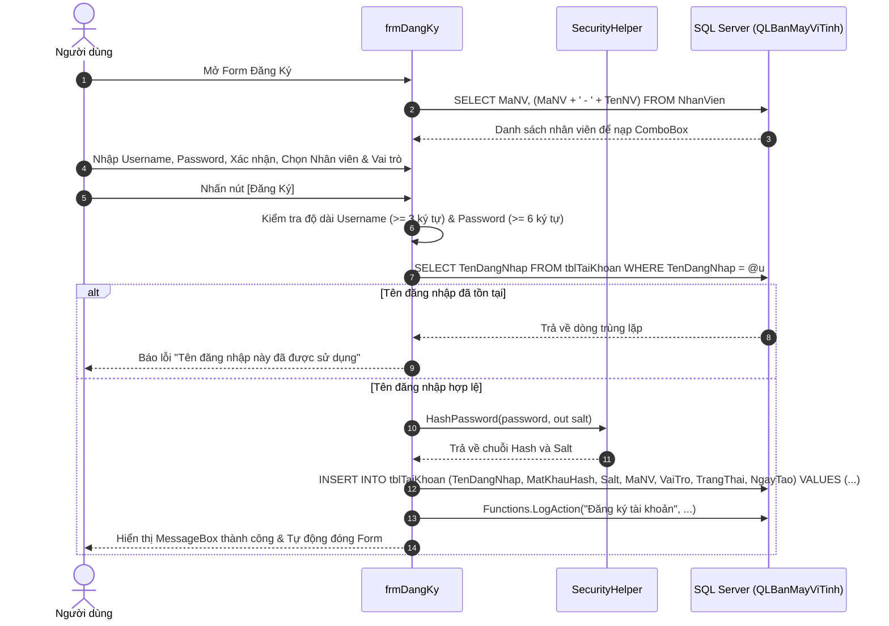

# BÁO CÁO KỸ THUẬT & HƯỚNG DẪN HOẠT ĐỘNG: FORM ĐĂNG KÝ TÀI KHOẢN (frmDangKy)

---

## 1. TỔNG QUAN VỀ FORM
- **Tên lớp (Class Name)**: `frmDangKy`
- **Tập tin mã nguồn**:
  - Code-behind: [Forms/frmDangKy.cs](file:///d:/HOCTRENLOP/LAPTRINHTRUCQUAN/BTLLAPTRINHTRUCQUAN/Forms/frmDangKy.cs)
  - UI Designer: [Forms/frmDangKy.Designer.cs](file:///d:/HOCTRENLOP/LAPTRINHTRUCQUAN/BTLLAPTRINHTRUCQUAN/Forms/frmDangKy.Designer.cs)
- **Mục đích nghiệp vụ**: Cho phép nhân viên hoặc người dùng mới tạo tài khoản đăng nhập vào hệ thống, liên kết tài khoản với hồ sơ nhân viên thực tế trong danh mục `NhanVien`.
- **Phân quyền truy cập (RBAC)**: Công khai từ màn hình đăng nhập hoặc từ quản trị viên.

---

## 2. CÔNG NGHỆ & THƯ VIỆN SỬ DỤNG
1. **Kiến trúc giao diện & Trải nghiệm (UI/UX)**:
   - Windows Forms (.NET Framework 4.7.2).
   - ComboBox liên kết dữ liệu quan hệ (Data Binding với bảng `NhanVien`).
   - Nhãn hiển thị lỗi tức thời (`lblThongBao`) dạng inline màu đỏ, không gây gián đoạn khó chịu bằng MessageBox khi người dùng gõ sai định dạng.
2. **Cơ sở dữ liệu & Truy vấn**:
   - `System.Data.SqlClient`: `SqlCommand`, `SqlDataReader`, Parameterized SQL (`@u`, `@h`, `@s`, `@nv`, `@v`).
   - Khóa ngoại liên kết `tblTaiKhoan.MaNV` tham chiếu `NhanVien.MaNV`.
3. **Bảo mật & Mã hóa**:
   - `SecurityHelper.HashPassword(password, out salt)`: Sinh ngẫu nhiên chuỗi Salt duy nhất và băm mật khẩu bằng thuật toán mật mã trước khi ghi vào CSDL.
   - Kiểm tra chống trùng tên đăng nhập bằng câu lệnh `SELECT TenDangNhap FROM tblTaiKhoan WHERE TenDangNhap = @u`.
   - Ràng buộc mật khẩu tối thiểu 6 ký tự và xác nhận mật khẩu 2 lần khớp nhau.

---

## 3. CÁCH HOẠT ĐỘNG & QUY TRÌNH NGHIỆP VỤ (LIFECYCLE & WORKFLOW)

### 3.1. Sơ đồ tuần tự (Sequence Diagram)


### 3.2. Quy tắc kiểm soát dữ liệu (Validation Rules)
1. **Tên đăng nhập**: Không được để trống, độ dài $\ge 3$ ký tự, không phân biệt hoa thường khi kiểm tra trùng.
2. **Mật khẩu**: Độ dài tối thiểu 6 ký tự.
3. **Xác nhận mật khẩu**: Phải khớp hoàn toàn với mật khẩu đã nhập (`password == confirm`).
4. **Nhân viên liên kết**: Cho phép chọn nhân viên chưa có tài khoản hoặc để trống (`DBNull.Value`).

---

## 4. CHI TIẾT MÃ NGUỒN & PHƯƠNG THỨC CHÍNH

### 4.1. Bảng danh sách phương thức
| Phương thức | Phạm vi | Chức năng chi tiết |
|:---|:---|:---|
| `frmDangKy_Load` | `private void` | Nạp danh sách nhân viên vào `cboNhanVien`, đặt mặc định vai trò `cboVaiTro` |
| `btnDangKy_Click` | `private void` | Kiểm tra điều kiện hợp lệ, kiểm tra trùng username, sinh Salt + Hash, chèn bản ghi mới vào CSDL |
| `btnDong_Click` | `private void` | Đóng màn hình đăng ký trở về màn hình trước |

### 4.2. Khối mã băm mật khẩu & Lưu vào CSDL
```csharp
string salt;
string hash = SecurityHelper.HashPassword(password, out salt);

string insertSql = @"INSERT INTO tblTaiKhoan (TenDangNhap, MatKhauHash, Salt, MaNV, VaiTro, TrangThai, NgayTao)
                     VALUES (@u, @h, @s, @nv, @v, N'Hoạt động', GETDATE())";

using (SqlCommand cmd = new SqlCommand(insertSql, Functions.Conn))
{
    cmd.Parameters.AddWithValue("@u", username);
    cmd.Parameters.AddWithValue("@h", hash);
    cmd.Parameters.AddWithValue("@s", salt);
    cmd.Parameters.AddWithValue("@nv", (object)maNV ?? DBNull.Value);
    cmd.Parameters.AddWithValue("@v", role);
    cmd.ExecuteNonQuery();
}
Functions.LogAction("Đăng ký tài khoản", "Tạo tài khoản mới: [" + username + "] với vai trò [" + role + "]");
```

---

## 5. ẢNH CHỤP MINH CHỨNG GIAO DIỆN
- **Chế độ Sáng (Light Mode)**: `Screenshots/frmDangKy_Light.png`
- **Chế độ Tối (Dark Mode)**: `Screenshots/frmDangKy_Dark.png`
- **Kiểm soát lỗi (Validation Error)**: `Screenshots/Verified/02_DangKy_Validation_Error.png`

