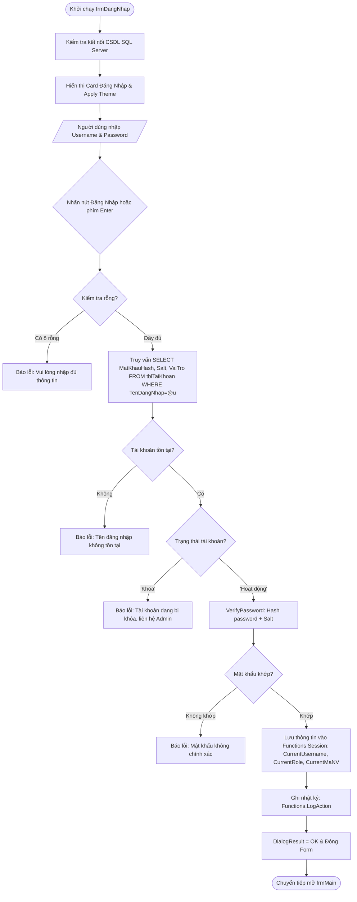

# BÁO CÁO KỸ THUẬT & HƯỚNG DẪN HOẠT ĐỘNG: FORM ĐĂNG NHẬP (frmDangNhap)

---

## 1. TỔNG QUAN VỀ FORM
- **Tên lớp (Class Name)**: `frmDangNhap`
- **Tập tin mã nguồn**: 
  - Code-behind: [Forms/frmDangNhap.cs](file:///d:/HOCTRENLOP/LAPTRINHTRUCQUAN/BTLLAPTRINHTRUCQUAN/Forms/frmDangNhap.cs)
  - UI Designer: [Forms/frmDangNhap.Designer.cs](file:///d:/HOCTRENLOP/LAPTRINHTRUCQUAN/BTLLAPTRINHTRUCQUAN/Forms/frmDangNhap.Designer.cs)
- **Mục đích nghiệp vụ**: Cửa sổ xác thực danh tính người dùng đầu tiên khi khởi động ứng dụng. Đảm bảo chỉ những người dùng hợp lệ, tài khoản không bị khóa mới được phép truy cập vào hệ thống ERP quản lý bán máy vi tính.
- **Phân quyền truy cập (RBAC)**: Công khai cho mọi người dùng trước phiên làm việc.

---

## 2. CÔNG NGHỆ & THƯ VIỆN SỬ DỤNG
1. **Kiến trúc giao diện (Presentation Layer)**:
   - Windows Forms (.NET Framework 4.7.2).
   - Fluent Bento Card: Sử dụng card đăng nhập bo góc (`UIThemeHelper.MakeRoundedControl`, radius = 10px).
   - Giao diện đáp ứng (Adaptive Theme): Tự động nạp theme Dark Mode hoặc Light Mode từ `UIThemeHelper`.
   - Tính năng ẩn/hiện mật khẩu động (`btnTogglePass`) với icon trạng thái.
2. **Cơ sở dữ liệu & Truy vấn**:
   - `System.Data.SqlClient`: Sử dụng `SqlCommand`, `SqlDataReader` với truy vấn tham số hóa (`@u`) 100% ngăn chặn SQL Injection.
   - Bảng CSDL thao tác: `tblTaiKhoan` và `NhanVien`.
3. **Bảo mật & Mã hóa**:
   - `SecurityHelper.VerifyPassword(password, storedHash, storedSalt)`: Băm mật khẩu kèm chuỗi Salt ngẫu nhiên bằng thuật toán mã hóa một chiều an toàn (SHA-256 + Salt).
   - Kiểm soát tài khoản bị vô hiệu hóa (`TrangThai == 'Khóa'`).
   - Audit Trail: Ghi nhật ký vào `tblNhatKyHoatDong` qua `Functions.LogAction()` ngay khi đăng nhập thành công.

---

## 3. CÁCH HOẠT ĐỘNG & QUY TRÌNH NGHIỆP VỤ (LIFECYCLE & WORKFLOW)

### 3.1. Sơ đồ luồng hoạt động (Activity Flowchart)


### 3.2. Chi tiết quy trình xử lý
1. **Khởi tạo (`frmDangNhap_Load`)**:
   - Kiểm tra chế độ `DesignMode` để tránh lỗi nạp dữ liệu khi mở form trong Visual Studio.
   - Tạo phong cách bo góc cho card đăng nhập `pnlLoginCard`, các ô nhập liệu `txtTenDangNhap`, `txtMatKhau` và các nút bấm `btnDangNhap`, `btnDangKy`.
   - Kết nối ngầm CSDL SQL Server qua `Functions.Connect()`.
2. **Sự kiện phím tắt (Keyboard Navigation)**:
   - `txtTenDangNhap_KeyDown`: Khi ấn `Enter`, tự động focus chuyển sang ô `txtMatKhau`.
   - `txtMatKhau_KeyDown`: Khi ấn `Enter`, tự động kích hoạt `btnDangNhap.PerformClick()`.
3. **Chức năng ẩn/hiện mật khẩu (`btnTogglePass_Click`)**:
   - Đảo cờ `isPasswordHidden`. Cập nhật `txtMatKhau.UseSystemPasswordChar = isPasswordHidden` và đổi icon sang biểu tượng tương ứng.
4. **Điều hướng liên kết**:
   - Nhấn "Quên mật khẩu?": Khởi tạo và hiển thị modal `frmQuenMatKhau.ShowDialog()`.
   - Nhấn "Đăng ký tài khoản": Hiển thị modal `frmDangKy.ShowDialog()`.
   - Nhấn "Cấu hình CSDL": Hiển thị modal cấu hình kết nối `frmCaiDat.ShowDialog()`.

---

## 4. CHI TIẾT MÃ NGUỒN & PHƯƠNG THỨC CHÍNH

### 4.1. Bảng danh sách phương thức
| Phương thức | Phạm vi | Chức năng chi tiết |
|:---|:---|:---|
| `frmDangNhap_Load` | `private void` | Nạp giao diện, styling bo góc, áp dụng theme, thử kết nối CSDL |
| `btnDangNhap_Click` | `private void` | Xác thực đăng nhập: kiểm tra dữ liệu, truy vấn tài khoản, verify mật khẩu hash, thiết lập phiên làm việc |
| `btnTogglePass_Click` | `private void` | Bật/tắt chế độ xem mật khẩu rõ dạng text hoặc che dấu chấm |
| `lnkQuenMatKhau_LinkClicked` | `private void` | Mở hộp thoại khôi phục mật khẩu qua số điện thoại |
| `btnDangKy_Click` | `private void` | Mở hộp thoại đăng ký tài khoản người dùng mới |
| `btnCaiDatDB_Click` | `private void` | Mở nhanh cửa sổ cấu hình chuỗi kết nối SQL Server nếu CSDL bị mất kết nối |

### 4.2. Khối mã xử lý xác thực trọng tâm
```csharp
string sql = "SELECT MatKhauHash, Salt, MaNV, VaiTro, TrangThai FROM tblTaiKhoan WHERE TenDangNhap = @u";
using (SqlCommand cmd = new SqlCommand(sql, Functions.Conn))
{
    cmd.Parameters.AddWithValue("@u", username);
    using (SqlDataReader reader = cmd.ExecuteReader())
    {
        if (reader.Read())
        {
            storedHash = reader["MatKhauHash"].ToString();
            storedSalt = reader["Salt"].ToString();
            maNV = reader["MaNV"] != DBNull.Value ? reader["MaNV"].ToString() : "";
            vaiTro = reader["VaiTro"].ToString();
            trangThai = reader["TrangThai"].ToString();
        }
    }
}
bool isValid = SecurityHelper.VerifyPassword(password, storedHash, storedSalt);
```

---

## 5. ẢNH CHỤP MINH CHỨNG GIAO DIỆN
- **Chế độ Sáng (Light Mode)**: `Screenshots/frmDangNhap_Light.png`
- **Chế độ Tối (Dark Mode)**: `Screenshots/frmDangNhap_Dark.png`
- **Tính năng Hiện/Ẩn mật khẩu**: `Screenshots/Verified/06_DangNhap_EyeToggled.png`
