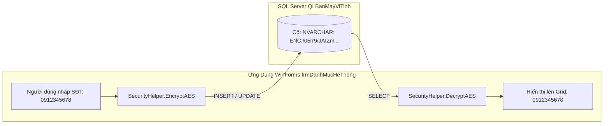

# BÁO CÁO KỸ THUẬT & HƯỚNG DẪN HOẠT ĐỘNG: FORM DANH MỤC HỆ THỐNG (frmDanhMucHeThong)

---

## 1. TỔNG QUAN VỀ FORM
- **Tên lớp (Class Name)**: `frmDanhMucHeThong`
- **Tập tin mã nguồn**:
  - Code-behind: [Forms/frmDanhMucHeThong.cs](file:///d:/HOCTRENLOP/LAPTRINHTRUCQUAN/BTLLAPTRINHTRUCQUAN/Forms/frmDanhMucHeThong.cs)
  - UI Designer: [Forms/frmDanhMucHeThong.Designer.cs](file:///d:/HOCTRENLOP/LAPTRINHTRUCQUAN/BTLLAPTRINHTRUCQUAN/Forms/frmDanhMucHeThong.Designer.cs)
- **Mục đích nghiệp vụ**: Quản trị tập trung toàn bộ danh mục nền tảng của hệ thống ERP trên một giao diện hợp nhất gồm 4 Tab: Khách Hàng, Nhà Cung Cấp, Nhân Viên và Danh Mục Linh Kiện Phần Cứng 3NF.
- **Phân quyền truy cập (RBAC)**: `Admin`, `ThuKho`, `BanHang` (được phân quyền hạn chế theo vai trò).

---

## 2. CÔNG NGHỆ, MÃ HÓA BẢO MẬT & KIỂM SOÁT LỖI
1. **Kiến trúc TabControl đa phân hệ**:
   - Tab 1: **Khách Hàng** (`KhachHang` - Quản lý hồ sơ đối tác mua lẻ, công nợ).
   - Tab 2: **Nhà Cung Cấp** (`NhaCungCap` - Quản lý nguồn hàng nhập khẩu và phân phối).
   - Tab 3: **Nhân Viên** (`NhanVien` - Quản lý nhân sự, giới tính, ngày sinh, chức vụ).
   - Tab 4: **Linh Kiện Phần Cứng** (Bộ điều khiển chuyển đổi động giữa 14 bảng danh mục: Chip, RAM, Ổ cứng, Dung lượng, Màn hình, Chuột, Bàn phím...).
2. **Mã hóa dữ liệu nhạy cảm chuẩn công nghiệp (AES-256-CBC)**:
   - Các trường thông tin cá nhân gồm **Số Điện Thoại** và **Địa Chỉ** của Khách Hàng, Nhân Viên và Nhà Cung Cấp được tự động mã hóa qua `SecurityHelper.EncryptAES()` trước khi lưu vào SQL Server (dạng chuỗi ciphertext `ENC:...`).
   - Khi truy vấn nạp lên DataGridView, hàm `SecurityHelper.DecryptAES()` tự động giải mã để người dùng đọc dạng số và văn bản thông thường, đảm bảo an toàn dữ liệu ngay cả khi CSDL bị trích xuất trái phép.
3. **Kiểm soát lỗi nhập liệu nghiêm ngặt (Input Validation)**:
   - **Xác thực số điện thoại**: Sử dụng biểu thức chính quy (Regex `^0[0-9]{9,10}$`) kiểm tra đầu số Việt Nam hợp lệ.
   - **Chặn ký tự lạ (`KeyPress`)**: Chỉ cho phép gõ số nguyên (`Functions.OnlyInteger`).
   - **Ràng buộc độ tuổi lao động**: Nhân viên phải từ đủ 15 tuổi trở lên (`DateTime.Now.Year - dtpNgaySinh.Value.Year >= 15`) và không được chọn ngày sinh ở tương lai.
   - **Bọc xử lý ngoại lệ**: 100% các thao tác CRUD đều được bao bọc trong `try-catch`, bắt lỗi khóa chính, khóa ngoại SQL và hiển thị thông báo tiếng Việt trực quan.

---

## 3. CÁCH HOẠT ĐỘNG & QUY TRÌNH NGHIỆP VỤ (LIFECYCLE & WORKFLOW)

### 3.1. Sơ đồ xử lý dữ liệu mã hóa AES-256


### 3.2. Chức năng quản trị động 14 bảng linh kiện (Tab 4)
- Tại Tab 4, người dùng chọn loại linh kiện trong ComboBox `cboLoaiDanhMuc` (ví dụ: *Bộ vi xử lý Chip*, *Bộ nhớ RAM*...).
- Hàm `GetCurrentTableName(out colMa, out colTen)` tự động phân giải tên bảng CSDL (`tblChip`, `tblRAM`...) và tên các cột tương ứng (`MaChip`, `TenChip`).
- Toàn bộ thao tác Thêm, Sửa, Xóa, Làm mới tại Tab 4 tự động ánh xạ chính xác vào bảng linh kiện đang được chọn mà không cần tạo 14 form riêng biệt.

---

## 4. CHI TIẾT MÃ NGUỒN & PHƯƠNG THỨC CHÍNH

### 4.1. Bảng danh sách phương thức
| Phương thức | Phạm vi | Chức năng chi tiết |
|:---|:---|:---|
| `frmDanhMucHeThong_Load` | `private void` | Khởi tạo giao diện, nạp dữ liệu Tab mặc định (Khách Hàng), cấu hình styling |
| `tabMain_SelectedIndexChanged`| `private void` | Khi người dùng chuyển Tab, tự động nạp dữ liệu tương ứng của Tab đó |
| `LoadDataKH` / `LoadDataNCC` / `LoadDataNV` | `private void` | Truy vấn CSDL, duyệt từng dòng để giải mã AES trường SĐT & Địa chỉ, gán vào DataTable |
| `btnThemKH_Click` / `btnSuaKH_Click` | `private void` | Validate định dạng SĐT, mã hóa AES và thực thi INSERT/UPDATE bảng Khách Hàng |
| `btnThemNV_Click` / `btnSuaNV_Click` | `private void` | Validate SĐT, kiểm tra độ tuổi nhân viên $\ge 15$, mã hóa AES và lưu thông tin nhân viên |
| `cboLoaiDanhMuc_SelectedIndexChanged`| `private void` | Tải dữ liệu linh kiện tương ứng vào lưới Tab 4 |
| `GetCurrentTableName` | `private string` | Hàm trợ giúp phân giải tên bảng và mã cột của 14 danh mục linh kiện 3NF |

### 4.2. Khối mã xác thực & mã hóa AES khi lưu Khách Hàng
```csharp
string sdt = txtDienThoaiKH.Text.Trim();
if (!System.Text.RegularExpressions.Regex.IsMatch(sdt, @"^0[0-9]{9,10}$"))
{
    MessageBox.Show("Số điện thoại không hợp lệ! Vui lòng nhập số điện thoại Việt Nam (10-11 chữ số bắt đầu bằng 0).", 
                    "Lỗi Định Dạng", MessageBoxButtons.OK, MessageBoxIcon.Warning);
    txtDienThoaiKH.Focus();
    return;
}

string encDC = SecurityHelper.EncryptAES(txtDiaChiKH.Text.Trim());
string encDT = SecurityHelper.EncryptAES(sdt);

string sql = "INSERT INTO KhachHang (MaKhach, TenKhach, DiaChi, DienThoai) VALUES (@m, @t, @dc, @dt)";
using (SqlCommand cmd = new SqlCommand(sql, Functions.Conn))
{
    cmd.Parameters.AddWithValue("@m", txtMaKH.Text.Trim());
    cmd.Parameters.AddWithValue("@t", txtTenKH.Text.Trim());
    cmd.Parameters.AddWithValue("@dc", encDC);
    cmd.Parameters.AddWithValue("@dt", encDT);
    cmd.ExecuteNonQuery();
}
```

---

## 5. ẢNH CHỤP MINH CHỨNG GIAO DIỆN
- **Tab 1: Khách Hàng**: `Screenshots/Verified/06_DanhMuc_Tab1_KhachHang.png`
- **Tab 2: Nhà Cung Cấp**: `Screenshots/Verified/06_DanhMuc_Tab2_NhaCungCap.png`
- **Tab 3: Nhân Viên**: `Screenshots/Verified/06_DanhMuc_Tab3_NhanVien.png`
- **Tab 4: Danh Mục Linh Kiện**: `Screenshots/Verified/06_DanhMuc_Tab4_LinhKien_RAM.png`, `06_DanhMuc_Tab4_LinhKien_Chip.png`
