# BÁO CÁO KỸ THUẬT & HƯỚNG DẪN HOẠT ĐỘNG: FORM TRANG CHỦ & ĐIỀU HƯỚNG (frmMain)

---

## 1. TỔNG QUAN VỀ FORM
- **Tên lớp (Class Name)**: `frmMain`
- **Tập tin mã nguồn**:
  - Code-behind: [Forms/frmMain.cs](file:///d:/HOCTRENLOP/LAPTRINHTRUCQUAN/BTLLAPTRINHTRUCQUAN/Forms/frmMain.cs)
  - UI Designer: [Forms/frmMain.Designer.cs](file:///d:/HOCTRENLOP/LAPTRINHTRUCQUAN/BTLLAPTRINHTRUCQUAN/Forms/frmMain.Designer.cs)
- **Mục đích nghiệp vụ**: Màn hình trung tâm (Main Shell/Dashboard) của toàn bộ phần mềm. Cung cấp kiến trúc Bento Grid hiện đại hiển thị KPI thời gian thực, điều hướng động giữa các phân hệ con (Child Forms), kiểm soát phân quyền người dùng (RBAC) và chuyển đổi giao diện Dark/Light mode toàn cục.
- **Phân quyền truy cập (RBAC)**: Tự động thích ứng theo 3 vai trò:
  - `Admin`: Toàn quyền tất cả các chức năng.
  - `BanHang`: Ẩn mục Phiếu Nhập, Quản lý người dùng, Cài đặt hệ thống.
  - `ThuKho`: Ẩn mục Hóa đơn bán, Quản lý người dùng.

---

## 2. CÔNG NGHỆ & THƯ VIỆN SỬ DỤNG
1. **Kiến trúc giao diện Bento Grid & Responsive**:
   - Kiến trúc Single Document Interface (SDI) với Panel chứa form con (`pnlContent.Controls.Add(childForm)`).
   - Layout đáp ứng động (`LayoutBentoDashboard()`): Tự động tính toán lại kích thước và vị trí các thẻ Bento (`pnlBentoHero`, `pnlBentoStock`, `pnlBentoSec`, `pnlBentoActions`, `pnlBentoAlerts`, `pnlBentoGridCard`) dựa trên kích thước cửa sổ của người dùng.
   - Bo góc và đổ bóng nhẹ (GDI+ Custom Painting & `UIThemeHelper`).
2. **Quản lý Theme động (Theme Engine)**:
   - `UIThemeHelper.OnThemeChanged`: Sử dụng mẫu thiết kế Observer (Event-driven) để thông báo thay đổi màu nền, màu chữ, viền cho tất cả control khi người dùng bấm nút `btnToggleTheme`.
   - Lưu trữ theme người dùng vào bảng `tblCauHinh` trong SQL Server để giữ nguyên trạng thái khi mở lại ứng dụng.
3. **Tổng hợp dữ liệu Dashboard thời gian thực**:
   - Sử dụng các truy vấn tổng hợp SQL (`SUM`, `COUNT`, `COALESCE`):
     - Tổng doanh thu tháng hiện tại từ `tblChiTietHDBan`.
     - Tổng vốn nhập hàng từ `tblChiTietHDNhap`.
     - Ước tính lợi nhuận gộp từ chênh lệch đơn giá.
     - Số lượng chủng loại máy và tổng tồn kho thực tế.
     - Cảnh báo các mẫu máy có lượng tồn thấp ($< 5$ chiếc).

---

## 3. CÁCH HOẠT ĐỘNG & QUY TRÌNH NGHIỆP VỤ (LIFECYCLE & WORKFLOW)

### 3.1. Sơ đồ kiến trúc điều hướng form con

```mermaid
flowchart TD
    subgraph frmMain [Khung Chính frmMain]
        Header[Thanh Tiêu Đề: Đồng hồ, Trạng thái CSDL, User Role, Nút Đổi Theme]
        Sidebar[Thanh Điều Hướng Bên Trái: Danh Mục, Máy Tính, Hóa Đơn, Báo Cáo, ...]
        ContentPanel[Khu Vực Hiển Thị Nội Dung pnlContent]
    end

    Sidebar -->|Nhấn Dashboard| Dash[Hiển thị Bento Grid KPI Overview]
    Sidebar -->|Nhấn Máy Vi Tính| F_MVT[Mở frmMayViTinh nhúng vào ContentPanel]
    Sidebar -->|Nhấn Hóa Đơn Bán| F_HDB[Mở frmHoaDonBan nhúng vào ContentPanel]
    Sidebar -->|Nhấn Hóa Đơn Nhập| F_HDN[Mở frmHoaDonNhap nhúng vào ContentPanel]
    Sidebar -->|Nhấn Danh Mục| F_DM[Mở frmDanhMucHeThong nhúng vào ContentPanel]
    Sidebar -->|Nhấn Tìm Kiếm| F_TK[Mở frmTimKiem nhúng vào ContentPanel]
    Sidebar -->|Nhấn Báo Cáo| F_BC[Mở frmBaoCaoThongKe nhúng vào ContentPanel]
    Sidebar -->|Nhấn Nhật Ký| F_NK[Mở frmNhatKyHoatDong nhúng vào ContentPanel]
    Sidebar -->|Nhấn Cài Đặt| F_CD[Mở frmCaiDat nhúng vào ContentPanel]

    ContentPanel --- Dash
    ContentPanel --- F_MVT
    ContentPanel --- F_HDB
    ContentPanel --- F_HDN
    ContentPanel --- F_DM
    ContentPanel --- F_TK
    ContentPanel --- F_BC
    ContentPanel --- F_NK
    ContentPanel --- F_CD
```


### 3.2. Cơ chế nhúng Form con (`OpenChildForm`)
```csharp
private void OpenChildForm(Form childForm, Button activeBtn)
{
    if (currentChildForm != null)
    {
        currentChildForm.Close();
        currentChildForm.Dispose();
    }
    currentChildForm = childForm;
    childForm.TopLevel = false;
    childForm.FormBorderStyle = FormBorderStyle.None;
    childForm.Dock = DockStyle.Fill;
    pnlContent.Controls.Add(childForm);
    pnlContent.Tag = childForm;
    pnlBentoDashboard.Visible = false;
    childForm.BringToFront();
    childForm.Show();
}
```

---

## 4. CHI TIẾT MÃ NGUỒN & PHƯƠNG THỨC CHÍNH

### 4.1. Bảng danh sách phương thức
| Phương thức | Phạm vi | Chức năng chi tiết |
|:---|:---|:---|
| `frmMain_Load` | `private void` | Kiểm tra kết nối CSDL, nạp theme, áp dụng RBAC, khởi tạo đồng hồ, kích hoạt layout Bento |
| `ApplyRBAC` | `private void` | Kiểm tra `Functions.CurrentRole` để ẩn/hiện các nút chức năng trên Sidebar và nút nhanh Bento |
| `ApplyBentoStyles` | `private void` | Tạo kiểu dáng bo góc, màu sắc thẻ Hero, Stock, Security, Quick Actions |
| `LayoutBentoDashboard`| `private void` | Tính toán tỷ lệ phần trăm Responsive khi cửa sổ thay đổi độ phân giải |
| `LoadDashboardKPIs` | `private void` | Chạy các câu lệnh SQL tổng hợp số liệu Doanh thu, Chi phí, Tồn kho, Lợi nhuận |
| `OpenChildForm` | `private void` | Đóng form con cũ, cấu hình form con mới không có viền và nhúng trực tiếp vào Panel |
| `btnToggleTheme_Click`| `private void` | Đảo trạng thái sáng/tối, gọi `UIThemeHelper.ToggleTheme()`, lưu vào CSDL và vẽ lại toàn bộ control |
| `btnDangXuat_Click` | `private void` | Xóa phiên đăng nhập, đóng form chính và khởi chạy lại `frmDangNhap` |

---

## 5. ẢNH CHỤP MINH CHỨNG GIAO DIỆN
- **Dashboard chế độ Sáng (Light Mode)**: `Screenshots/Verified/00_Main_Dashboard_Light.png`
- **Dashboard chế độ Tối (Dark Mode)**: `Screenshots/Verified/00_Main_Dashboard_Dark.png`
- **Điều hướng mở form con**: `Screenshots/Verified/00_Main_Nav_MayTinh.png`, `Screenshots/Verified/00_Main_Nav_HDBan.png`
