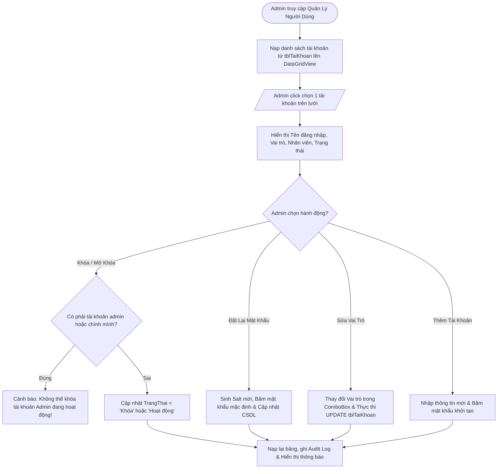

# BÁO CÁO KỸ THUẬT & HƯỚNG DẪN HOẠT ĐỘNG: FORM QUẢN LÝ NGƯỜI DÙNG & PHÂN QUYỀN (frmQuanLyNguoiDung)

---

## 1. TỔNG QUAN VỀ FORM
- **Tên lớp (Class Name)**: `frmQuanLyNguoiDung`
- **Tập tin mã nguồn**:
  - Code-behind: [Forms/frmQuanLyNguoiDung.cs](file:///d:/HOCTRENLOP/LAPTRINHTRUCQUAN/BTLLAPTRINHTRUCQUAN/Forms/frmQuanLyNguoiDung.cs)
  - UI Designer: [Forms/frmQuanLyNguoiDung.Designer.cs](file:///d:/HOCTRENLOP/LAPTRINHTRUCQUAN/BTLLAPTRINHTRUCQUAN/Forms/frmQuanLyNguoiDung.Designer.cs)
- **Mục đích nghiệp vụ**: Phân hệ quản trị bảo mật cao cấp dành riêng cho Quản trị viên (Admin). Cho phép tạo mới người dùng, điều chỉnh vai trò phân quyền (Role-Based Access Control), kích hoạt hoặc khóa tài khoản nghi vấn và đặt lại mật khẩu an toàn.
- **Phân quyền truy cập (RBAC)**: Chỉ duy nhất vai trò `Admin`.

---

## 2. CÔNG NGHỆ & CƠ CHẾ BẢO MẬT TÀI KHOẢN
1. **Kiến trúc quản trị tài khoản `tblTaiKhoan`**:
   - Quản lý các thuộc tính: `TenDangNhap`, `MatKhauHash`, `Salt`, `MaNV`, `VaiTro`, `TrangThai`, `NgayTao`.
   - Kết nối với bảng `NhanVien` để hiển thị tên thật và chức vụ của người sở hữu tài khoản.
2. **Cơ chế khóa an toàn chống tự khóa (Self-Lockout Protection)**:
   - Hệ thống ngăn chặn việc Admin vô tình hoặc cố ý khóa tài khoản gốc (`admin`) hoặc tài khoản của chính mình đang đăng nhập (`username == Functions.CurrentUsername`).
3. **Thuật toán cấp lại mật khẩu (Password Reset Mechanism)**:
   - Khi Admin ấn nút [Đặt Lại MK], phần mềm sinh ngẫu nhiên Salt mới, băm mật khẩu mặc định an toàn (`123456` hoặc chuỗi do Admin cấp) và cập nhật trực tiếp vào CSDL, yêu cầu người dùng đổi lại mật khẩu ở lần đăng nhập tiếp theo.

---

## 3. CÁCH HOẠT ĐỘNG & QUY TRÌNH NGHIỆP VỤ (LIFECYCLE & WORKFLOW)

### 3.1. Sơ đồ xử lý quản trị tài khoản


---

## 4. CHI TIẾT MÃ NGUỒN & PHƯƠNG THỨC CHÍNH

### 4.1. Bảng danh sách phương thức
| Phương thức | Phạm vi | Chức năng chi tiết |
|:---|:---|:---|
| `frmQuanLyNguoiDung_Load` | `private void` | Kiểm tra quyền Admin, cấu hình theme, nạp danh sách tài khoản và danh sách nhân viên |
| `LoadGrid` | `private void` | Truy vấn danh sách tài khoản kết hợp `LEFT JOIN NhanVien` nạp lên lưới |
| `dgvTaiKhoan_CellClick` | `private void` | Bind dữ liệu dòng được chọn lên các ô nhập liệu và đổi text nút Khóa/Mở Khóa |
| `btnThem_Click` | `private void` | Kiểm tra username trùng, băm mật khẩu và tạo tài khoản mới |
| `btnSua_Click` | `private void` | Cập nhật Vai trò và Nhân viên liên kết cho tài khoản |
| `btnKhoaMoKhoa_Click` | `private void` | Đảo trạng thái tài khoản giữa 'Hoạt động' và 'Khóa' (có kiểm tra bảo vệ Admin) |
| `btnDatLaiMK_Click` | `private void` | Đặt lại mật khẩu về giá trị mặc định kèm sinh Salt mới |

### 4.2. Khối mã bảo vệ chống tự khóa tài khoản Admin
```csharp
string username = txtTenDangNhap.Text.Trim();
if (username.Equals("admin", StringComparison.OrdinalIgnoreCase) || 
    username.Equals(Functions.CurrentUsername, StringComparison.OrdinalIgnoreCase))
{
    MessageBox.Show("Không thể khóa tài khoản Quản trị viên tối cao hoặc tài khoản đang đăng nhập hiện tại!", 
                    "Cảnh Báo Bảo Mật", MessageBoxButtons.OK, MessageBoxIcon.Warning);
    return;
}

string trangThaiMoi = (lblTrangThaiHienTai.Text == "Hoạt động") ? "Khóa" : "Hoạt động";
string sql = "UPDATE tblTaiKhoan SET TrangThai = @tt WHERE TenDangNhap = @u";
using (SqlCommand cmd = new SqlCommand(sql, Functions.Conn))
{
    cmd.Parameters.AddWithValue("@tt", trangThaiMoi);
    cmd.Parameters.AddWithValue("@u", username);
    cmd.ExecuteNonQuery();
}
Functions.LogAction("Quản lý tài khoản", "Đổi trạng thái tài khoản [" + username + "] sang [" + trangThaiMoi + "]");
```

---

## 5. ẢNH CHỤP MINH CHỨNG GIAO DIỆN
- **Chế độ Sáng (Light Mode)**: `Screenshots/frmQuanLyNguoiDung_Light.png`
- **Chế độ Tối (Dark Mode)**: `Screenshots/frmQuanLyNguoiDung_Dark.png`
- **Giao diện khi chọn tài khoản**: `Screenshots/Verified/11_NguoiDung_Selected_User.png`
- **Trạng thái Thêm tài khoản mới**: `Screenshots/Verified/11_NguoiDung_State_ThemMoi.png`
