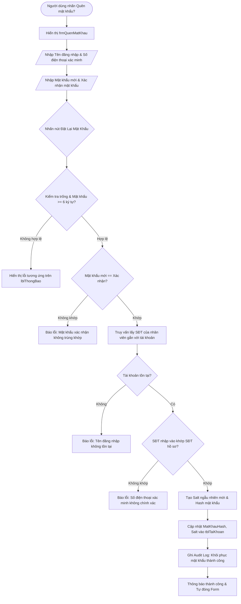

# BÁO CÁO KỸ THUẬT & HƯỚNG DẪN HOẠT ĐỘNG: FORM QUÊN MẬT KHẨU (frmQuenMatKhau)

---

## 1. TỔNG QUAN VỀ FORM
- **Tên lớp (Class Name)**: `frmQuenMatKhau`
- **Tập tin mã nguồn**:
  - Code-behind: [Forms/frmQuenMatKhau.cs](file:///d:/HOCTRENLOP/LAPTRINHTRUCQUAN/BTLLAPTRINHTRUCQUAN/Forms/frmQuenMatKhau.cs)
  - UI Designer: [Forms/frmQuenMatKhau.Designer.cs](file:///d:/HOCTRENLOP/LAPTRINHTRUCQUAN/BTLLAPTRINHTRUCQUAN/Forms/frmQuenMatKhau.Designer.cs)
- **Mục đích nghiệp vụ**: Cung cấp cơ chế tự phục hồi tài khoản an toàn cho nhân viên khi quên mật khẩu thông qua việc đối soát Số điện thoại đã đăng ký trong hồ sơ nhân viên.
- **Phân quyền truy cập (RBAC)**: Công khai từ màn hình đăng nhập.

---

## 2. CÔNG NGHỆ & THƯ VIỆN SỬ DỤNG
1. **Kiến trúc giao diện & Trải nghiệm (UI/UX)**:
   - Windows Forms (.NET Framework 4.7.2).
   - Form dạng Modal Dialog gọn gàng, tự động định tâm giữa màn hình (`StartPosition = FormStartPosition.CenterParent`).
2. **Cơ sở dữ liệu & Truy vấn**:
   - Truy vấn kết hợp `tblTaiKhoan` với `NhanVien` bằng phép nối ngoài `LEFT JOIN`:
     ```sql
     SELECT tk.TenDangNhap, tk.MaNV, nv.DienThoai
     FROM tblTaiKhoan tk
     LEFT JOIN NhanVien nv ON tk.MaNV = nv.MaNV
     WHERE tk.TenDangNhap = @u
     ```
3. **Bảo mật & Thuật toán xác minh**:
   - Đối chiếu số điện thoại nhập vào với số điện thoại thực tế trong hồ sơ nhân viên.
   - Khi khớp điều kiện xác minh, sinh Salt mới và mã hóa mật khẩu mới trước khi cập nhật (`UPDATE tblTaiKhoan SET MatKhauHash = @h, Salt = @s WHERE TenDangNhap = @u`).
   - Ghi vết hành động khôi phục vào nhật ký hoạt động hệ thống `tblNhatKyHoatDong`.

---

## 3. CÁCH HOẠT ĐỘNG & QUY TRÌNH NGHIỆP VỤ (LIFECYCLE & WORKFLOW)

### 3.1. Sơ đồ luồng hoạt động


---

## 4. CHI TIẾT MÃ NGUỒN & PHƯƠNG THỨC CHÍNH

### 4.1. Bảng danh sách phương thức
| Phương thức | Phạm vi | Chức năng chi tiết |
|:---|:---|:---|
| `frmQuenMatKhau_Load` | `private void` | Cấu hình theme nút bấm và nhãn thông báo |
| `btnDatLaiMatKhau_Click` | `private void` | Thẩm định các trường nhập liệu, kiểm tra đối soát số điện thoại hồ sơ nhân viên và cập nhật mật khẩu băm mới |
| `btnDong_Click` | `private void` | Đóng form khôi phục mật khẩu |

### 4.2. Khối mã cập nhật mật khẩu mới
```csharp
string salt;
string hash = SecurityHelper.HashPassword(newPass, out salt);

string sqlUpdate = "UPDATE tblTaiKhoan SET MatKhauHash = @h, Salt = @s WHERE TenDangNhap = @u";
using (SqlCommand cmd = new SqlCommand(sqlUpdate, Functions.Conn))
{
    cmd.Parameters.AddWithValue("@h", hash);
    cmd.Parameters.AddWithValue("@s", salt);
    cmd.Parameters.AddWithValue("@u", username);
    cmd.ExecuteNonQuery();
}
Functions.LogAction("Khôi phục mật khẩu", "Tài khoản [" + username + "] đã đặt lại mật khẩu mới thành công");
```

---

## 5. ẢNH CHỤP MINH CHỨNG GIAO DIỆN
- **Chế độ Sáng (Light Mode)**: `Screenshots/frmQuenMatKhau_Light.png`
- **Chế độ Tối (Dark Mode)**: `Screenshots/frmQuenMatKhau_Dark.png`
- **Kiểm soát xác thực (Validation Error)**: `Screenshots/Verified/03_QuenMatKhau_Validation_Error.png`
